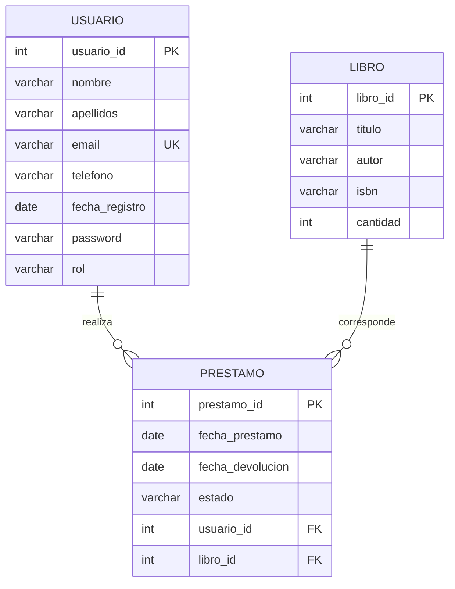

# Producto 2 · MVC, JPA y CRUD

## Correspondencia con el enunciado

- Tres entidades persistentes: `Libro`, `Usuario`, `Prestamo`.
- Tres repositorios JPA.
- Controladores Spring MVC.
- Vistas Thymeleaf para listados y formularios.
- CRUD completo para las tres entidades (el enunciado exige al menos una).
- MySQL mediante Docker Compose.
- Interfaz Bootstrap responsive.

## Diagrama E/R



> `password` y `rol` son la ampliación del Producto 3; la estructura base Usuario-Libro-Préstamo procede del Producto 2.

## Mockup funcional

```text
+-------------------------------------------------------------+
| Spring Library        Libros      [Usuarios] [Préstamos]    |
+-------------------------------------------------------------+
|                    PANEL PRINCIPAL                          |
|                                                             |
|   +-------------+  +-------------+  +------------------+    |
|   |   LIBROS    |  |  USUARIOS   |  |    PRÉSTAMOS     |    |
|   | listado     |  | listado     |  | listado          |    |
|   | formulario  |  | formulario  |  | formulario       |    |
|   +-------------+  +-------------+  +------------------+    |
+-------------------------------------------------------------+
```

Cada módulo dispone de listado y, para el rol administrador, acciones de alta, edición y borrado.
