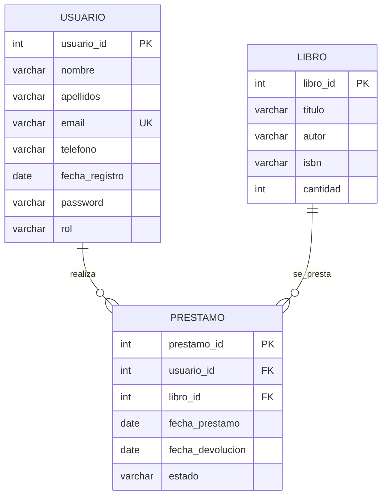

# Producto 3 · Usuarios, seguridad y roles

## Ampliación del modelo

El usuario de negocio del Producto 2 pasa a ser también la cuenta de autenticación. Se incorporan:

- `password`: se almacena cifrada con BCrypt.
- `rol`: `ADMIN` o `USER`.
- `email`: identificador de acceso y valor único.
- La relación `Usuario 1:N Prestamo` se utiliza para mostrar únicamente los préstamos pertenecientes al usuario autenticado en `/user/prestamos`.

## Diagrama E/R actualizado

## Seguridad

- `/login` y `/register`: públicas.
- `/admin/**`: sólo `ROLE_ADMIN`.
- Todas las operaciones que crean, modifican o eliminan filas se realizan bajo `/admin/**`.
- `/user/**`: accesible para usuarios autenticados (`USER` y `ADMIN`).
- `/user/prestamos`: filtra por el email autenticado y evita que un usuario consulte los préstamos de otro.
- Contraseñas con BCrypt.

## Flujo de registro

1. El visitante abre `/register`.
2. Se validan nombre, apellidos, email y contraseña.
3. Se impiden emails duplicados.
4. La contraseña se cifra con BCrypt.
5. Se asigna automáticamente `USER`.
6. El usuario inicia sesión mediante `/login`.

## Cambios Docker

- MySQL fijado a `mysql:8.4` en lugar de `mysql:latest` para evitar cambios inesperados de versión.
- Usuario de aplicación `biblio` en lugar de conectar como `root`.
- Base de datos publicada en `3310` para evitar conflicto con otros proyectos en `3307`.
- Aplicación publicada en `8090` para evitar conflicto con servicios que usan `8080`.
- Healthcheck de MySQL y dependencia de arranque de la aplicación.
- Volumen persistente para la base de datos.
